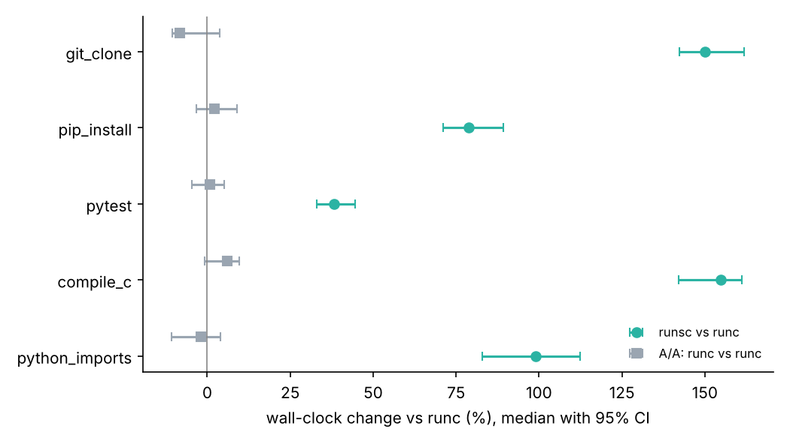
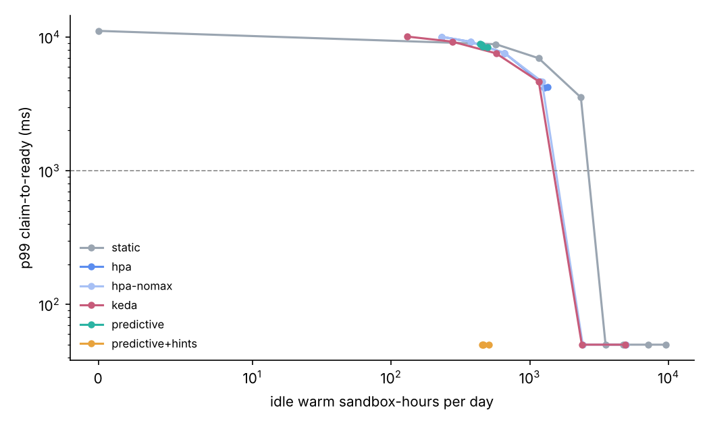

# SandboxBench

A controlled benchmark of agent-sandbox runtimes (runc vs gVisor) on agent-shaped workloads, with an A/A noise floor on every comparison, isolation checks from inside the sandbox, and a warm-pool sizing study for bursty sandbox claims (eval suites, RL steps).

## Results

Measured on one 2-vCPU VM without KVM (sections 1 to 6), and simulated (section 7). Full tables: [`results/SUMMARY.md`](results/SUMMARY.md). Method and threats to validity: [`docs/METHOD.md`](docs/METHOD.md).

**Wall-clock overhead of gVisor (runsc, systrap) vs runc**, 8 interleaved repetitions, 95% paired bootstrap CI, and the A/A noise floor (runc vs an identical runc):

| workload | runc | runsc | runsc vs runc | A/A |
|---|---|---|---|---|
| git clone + checkout (flask) | 1.39 s | 3.47 s | **+150%** [+142, +162] | -8% [-10, +4] |
| pip install into a venv (pytest, flask, requests, numpy) | 5.45 s | 9.75 s | **+79%** [+71, +89] | +2% [-3, +9] |
| pytest, 663 tests | 2.93 s | 4.05 s | **+38%** [+33, +45] | +1% [-5, +5] |
| build Lua with make -j2 | 3.80 s | 9.67 s | **+155%** [+142, +161] | +6% [-1, +10] |
| 20 python3 startups with imports | 2.16 s | 4.30 s | **+99%** [+83, +112] | -2% [-11, +4] |



**Lifecycle** (40 repetitions): claim to first exec (create + start + first exec) **70 ms runc vs 232 ms runsc** (3.3x, CI 3.1 to 3.5; A/A 1.01x); teardown 116 ms vs 1.36 s. Exec into a running sandbox: 29 vs 31 ms for `/bin/true`, 35 vs 74 ms for `python3 -c pass`.

**Why**: the syscall micro-benchmarks show where the time goes. A raw `getpid` costs 146 ns under runc and 5.0 us under runsc (35x: every syscall is trapped and served by the Sentry); fork+exec 1.3 ms vs 12.9 ms (9.7x); `stat` on the bind-mounted /work 13.5x, on the sandbox's own tmpfs 6.9x; sequential I/O only 1.3x (write) and 2.2x (read). Workloads made of many processes and small file operations (compiles, clones, interpreter startups) pay the most; a long-running test process pays least.

**Memory**: an idle runsc sandbox costs 13.3 MiB PSS across 5 host processes (Sentry, gofer, stubs), about 4,900 idle sandboxes per 64 GiB from overhead alone; runc's container process is 0.2 MiB (no containerd shim in this harness).

**Warm state: checkpoint/restore and pause/resume** (10 repetitions per runtime, 0 errors). The sandbox's init process imports json, sqlite3, numpy, pandas and matplotlib (a data-analysis agent's first step), then writes a heartbeat file every 5 ms.

| | runc | runsc |
|---|---|---|
| cold create + start until the imports finish (p50 / p90) | 468 / 690 ms | 1,328 / 1,559 ms |
| of which the imports, timed inside the sandbox (median) | 423 ms | 1,069 ms |
| checkpoint of the warm sandbox (p50), image on disk | not measured (needs CRIU) | 438 ms, 14 MiB |
| restore into a new container until the heartbeat advances (p50 / p90) | not measured | **466 / 476 ms** |
| pause / resume (p50) | 7 / 7 ms | 25 / 23 ms |

Restoring a warm gVisor sandbox is 2.8x faster than starting one cold, and about as fast as a cold runc start, because the imports are most of a cold start and restore skips them. Two limits on that number: "running again" means the heartbeat loop advanced, which touches little memory, so page faults on the restored working set during the first real call are not measured (the cost REAP and FaaSnap attack with working-set prefetch); and every restore from one image starts with identical process state (random-number state, temp names), which a pool built on restore has to re-seed.

**Isolation** (memory limit 256 MiB, pids limit 64, no network): both runtimes block the cloud metadata endpoint, DNS, writes to the root, mounts and extra interfaces. Differences that matter for operating them:

- runsc shows kernel `4.4.0` to the workload and does not apply the OCI seccomp profile to it (`Seccomp: 0`; the Sentry itself runs under the host filter, and app syscalls never reach the host kernel directly). `unshare -U` is allowed inside runsc because the Sentry implements user namespaces itself.
- **Limits fail differently.** Allocating 512 MiB under a 256 MiB limit kills the one process under runc; under runsc the host OOM killer takes the **whole sandbox**. Starting 200 processes under a pids limit of 64 stops at 62 under runc; under runsc the host's pids controller rejects the Sentry's own threads and stub processes (`fork rejected by pids controller` in the kernel log) and the **sandbox dies**. With gVisor, host cgroup limits must be sized for the Sentry, not the app.

**Warm pool (simulated, two weeks of claims, scored on week two)**:

| policy | p99 claim to ready | claims over 1 s SLO | idle sandbox-hours/day | RL GPU stall/day |
|---|---|---|---|---|
| upstream HPA example (claim rate, min 10, max 100), best setting | 4.2 s | 16.9% | 1,268 | 843 s |
| HPA on claim rate without the max, cheapest setting meeting p99 | 50 ms | 0.79% (eval p99 6.9 s) | 2,411 | 20 s |
| static pool, cheapest size meeting p99 (150) | 50 ms | 0.11% | 3,522 | 13 s |
| **predictive + hints** | **50 ms** | 0.36% (eval p99 50 ms) | **454** | 19 s |
| predictive, no hints | 8.9 s | 8.9% | 440 | 230 s |



The predictive policy holds a newsvendor quantile of steady demand learned per minute of day, detects periodic batch claimers (RL steps) by batch size, and pre-warms announced batches 30 s ahead. **Hints are what make it work**: the eval scheduler announces each suite and the RL trainer announces its next step when training starts. Without hints, unannounced eval launches (100 claims at once) and the first RL steps of a day still wait for creation, and p99 stays at creation time. Rate-driven autoscaling (HPA, KEDA) reacts after the burst has arrived, so eval first waves wait about 7 s at p99 at any setting.

## What is here

```
cmd/sandboxbench   harness: coldstart, exec, workloads, memory, isolation, snapshot (JSON per experiment)
internal/oci       the one OCI bundle both runtimes run
internal/rt        drives runc / runsc through their CLIs and times every stage
internal/work      workload corpus and isolation checks
internal/stats     percentiles, paired bootstrap CIs for ratios of medians
bench/micro        syscall micro-benchmarks (static C binary)
controller/        warm-pool simulator, claim workload model, policies (static, HPA, KEDA, predictive)
cmd/poolsim        runs every policy over two simulated weeks
bench/             prepare.sh (corpus), rootfs.sh, run_all.sh, plot.py
docs/METHOD.md     how noise is controlled, what each number means, threats to validity
```

## Reproduce

```
# root, runc, and runsc on PATH (runsc built here from gVisor's go branch: go build ./runsc)
bench/prepare.sh      # once: git mirrors, wheels, Lua source, micro-benchmark binary
bench/run_all.sh      # about 25 minutes: results/*.json, pool.jsonl, SUMMARY.md, figures
go test ./...
```

## What is not here

- **Kata Containers / Firecracker / Cloud Hypervisor**: need KVM; this VM has none (it is itself a Firecracker guest without nested virtualisation). The harness takes any OCI runtime binary, so adding Kata on a KVM host is a flag (`-runsc` points at any runtime; add an arm in `main.go`).
- **runc checkpoint/restore**: needs CRIU, which could not be installed here, so the warm-state table has a restore arm for gVisor only.
- **Kubernetes**: runtimes are driven through their CLIs, the way a containerd shim does, not through kubelet; pod scheduling and image pulls are modelled in the simulation (lognormal, median 2 s), not measured.
- **The warm-pool controller is a simulation and a policy**, not a controller running against `SandboxWarmPool` objects. The workload is synthetic (shapes of eval and RL claimers), not a production trace.
- **Upstream**: nothing was contributed to kubernetes-sigs/agent-sandbox. The natural pieces are issue #403 (benchmark JSON output with an A/A noise floor and paired CIs, which is what this harness emits) and a warm-pool sizing proposal with launch hints. Claim them only once merged.
- runsc is built from source at gVisor's go-branch commit ace9117e (the last one that builds with the Go 1.24 toolchain available here), so `runsc --version` prints `VERSION_MISSING`.

## Resume bullets (numbers from `results/`; keep "simulated" on the pool bullet)

- Built SandboxBench, a Go benchmark of runc and gVisor (systrap) agent sandboxes on five agent workloads with an A/A noise floor and paired bootstrap CIs, finding gVisor adds 38% (pytest) to 155% (C build) wall-clock, 3.3x claim-to-first-exec latency (232 vs 70 ms) and 13 MiB per idle sandbox, traced to 35x syscall and 9.7x fork+exec costs.
- Measured warm-state restore for agent sandboxes: a gVisor checkpoint (438 ms, 14 MiB) of a sandbox with numpy, pandas and matplotlib imported restored to running in 466 ms p50, 2.8x faster than a cold gVisor start (1,328 ms) and on par with a cold runc start (468 ms).
- Found that gVisor turns host cgroup limits into sandbox kills: memory and pids limits that stop one process under runc took down the whole runsc sandbox, so limits must be sized for the Sentry.
- Designed a predictive warm-pool policy (per-minute newsvendor demand, batch-period detection, launch hints from eval and RL schedulers) that in simulation held p99 claim latency at 50 ms through 100-sandbox eval launches and 128-sandbox RL steps with 81% fewer idle sandbox-hours than HPA on claim rate at the same p99 (454 vs 2,411 per day).

## Interview defence

- *Why is gVisor slow on IO-heavy work?* Every syscall traps out of the application into the Sentry (35x on a bare `getpid` here), and file operations outside the sandbox's own memory-backed filesystems go through the gofer or Sentry-opened host fds with extra validation: `stat` on the bind mount is 13.5x, on the internal tmpfs 6.9x. Bulk sequential I/O amortises this (1.3x to 2.2x); many small operations do not.
- *What is systrap?* gVisor's default platform since 2023: application threads run under a seccomp filter that returns `SECCOMP_RET_TRAP` for syscalls; a stub process per address space handles the signal and hands the syscall to the Sentry through shared memory, avoiding ptrace's context-switch cost and not needing KVM.
- *How do you size a pool for step-function bursts?* Rate-based autoscalers see a step only after it happened. Separate steady demand (forecast a quantile per time of day; the quantile is the newsvendor critical ratio between a claim waiting and a sandbox idling) from batch claimers (predict their period, or better, have the scheduler announce them), and pre-warm one creation lead time ahead, where lead time includes the creation-concurrency limit (128 sandboxes at 32 in flight take about 10 s).
- *Restore from a snapshot or keep a warm pool?* A warm pool pays idle memory for every sandbox it holds; restore pays one image per warm state (14 MiB here) and about 0.47 s per claim. Restore wins when warm states are expensive to build (imports, a cloned repo) and claims can wait half a second; a pool wins under a 50 ms claim SLO. The measured 466 ms is time until the process runs, not until its working set is back in memory, which is why REAP records and prefetches the working set and FaaSnap loads it concurrently.
- *Security model, gVisor vs microVMs?* gVisor puts a user-space kernel between the app and the host kernel (a much smaller host syscall surface, same host kernel underneath); a microVM puts a guest kernel behind hardware virtualisation (a VMM and KVM as the boundary). gVisor needs no KVM and starts in hundreds of milliseconds; microVMs pay for memory and a guest kernel but run unmodified kernels and syscalls at native speed inside the guest.
