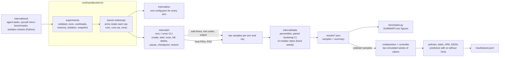

# Architecture

How the harness and the pool simulator are put together. How noise is controlled and what each number means is
in [`METHOD.md`](METHOD.md).

## Packages

| package | role |
|---|---|
| `cmd/sandboxbench` | runs each experiment over all arms with the arm order rotated every repetition, writes `results/<experiment>.json` with raw samples and the summary |
| `internal/oci` | builds the single OCI bundle (read-only root, no network, seccomp deny list, optional memory and pids limits) both runtimes run |
| `internal/rt` | drives a runtime through its CLI, the way a containerd shim would, and times each stage; finds a runtime's host processes for memory accounting |
| `internal/work` | the workload corpus and the isolation checks |
| `internal/stats` | percentiles and paired percentile-bootstrap intervals for ratios of medians, seeded so a re-run of the summary is identical |
| `controller` | the warm-pool simulator: claim workload (interactive, eval suites, RL steps), infrastructure model fed by measured cold starts, policies |
| `cmd/poolsim` | runs every policy over the simulated weeks and writes `results/pool.jsonl` |

## What CI checks without root or runsc

- unit tests for every package, including the CLI driver against a fake runtime script;
- the workload and cold-start summaries recomputed from the committed raw samples equal the committed summaries;
- the pool simulation reproduces `results/pool.jsonl` byte for byte.
